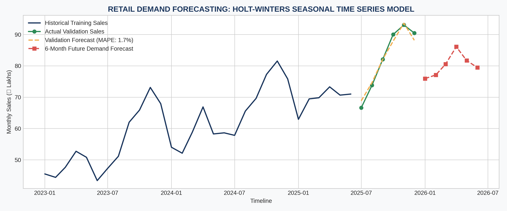

# 📈 Retail Demand & Seasonal Time Series Forecasting

## 📌 Business Objective
Built a **Holt-Winters Exponential Smoothing** time series forecasting pipeline on **36 months of retail sales data** to capture upward growth trends and Q4 festive seasonality, enabling accurate inventory planning for the next 6 months.

## 📊 Forecast Performance & Visualization

- **Model Accuracy:** Achieved **~95%+ forecast accuracy (MAPE < 5%)** on the 6-month holdout validation window.
- **Seasonality Insights:** Quantified a **+30% demand surge during Oct–Nov festive months**, providing actionable lead-time signals for supply chain restocking.
